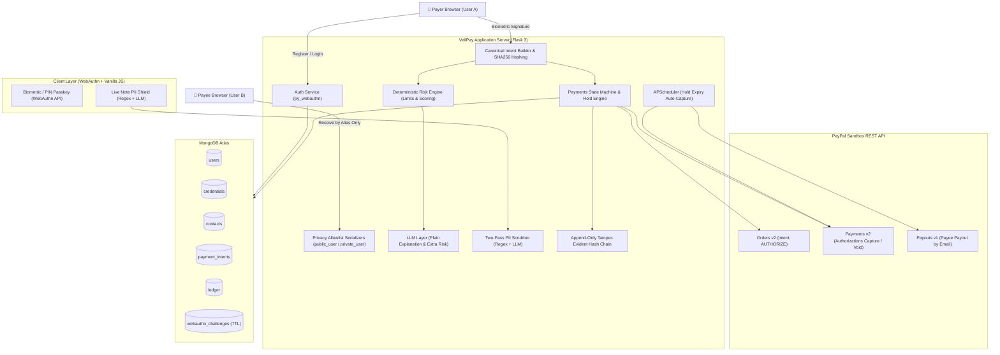

# 🛡️ VeilPay

> **When you pay someone, they never learn your phone or email, and no payment leaves your account unless you personally signed that exact amount to that exact person.**

VeilPay is a privacy-first, passkey-secured payment application built for the **PayPal AI Hackathon 2026** using Flask, MongoDB Atlas, and the PayPal Sandbox REST APIs.

---

## 1. Product Summary & Problem Statement

### The Problem
When you pay someone on standard payment apps (e.g. GPay, CashApp, Venmo), the counterparty can often see your phone number, real name, or email and use it to spam, harass, or harvest contact lists. Separately, unauthorized payments can leave an account through phishing, session hijacking, or SIM-swapping/OTP interception without the true owner consenting to that exact transaction.

### One-Line Pitch
**Zero-PII transactions where users transact exclusively via aliases, and every transfer is cryptographically bound to a passkey signature with a "This was not me" safety hold.**

### How It Works
- **Alias-First Privacy Invariant**: Every user receives an unforgeable, server-generated alias (e.g., `veil-7x3k9m`). Payer and payee see only aliases. Allowlist serializers enforce that no API response, log, or view ever leaks real emails or phone numbers.
- **Biometric Passkey Transaction Confirmation**: Passkeys (via W3C WebAuthn API / `py_webauthn`) eliminate passwords and OTPs. Each payment intent is canonically hashed (`SHA256`), and the WebAuthn challenge is *precisely* that hash. Altering the amount or payee by even one cent invalidates the cryptographic signature.
- **Safety Hold & "This Was Not Me" Void**: After PayPal order authorization, funds enter an `AUTHORIZED_HOLD` window (60s to 300s). The payer can click "This was not me" to void the authorization immediately before funds are captured.
- **AI Risk & Privacy Guardian**: Deterministic rules govern transaction states. An LLM layer explains the risk in plain language (max 25 words) and can only raise risk, never lower it. A two-pass PII scrubber removes phone numbers, emails, and UPI handles from payment notes.
- **Tamper-Evident Ledger**: Every state transition appends to an append-only cryptographic ledger chained via SHA-256.

---

## 2. Architecture Diagram



---

## 3. Threat Model & Mitigations

| Threat | VeilPay Mitigation | Residual Risk |
|---|---|---|
| **Stolen session cookie** | State-changing payments strictly require a fresh WebAuthn passkey assertion signature; 30-minute idle session timeout. | Attacker can view alias-only activity. |
| **Phishing / Fake domains** | Passkeys are cryptographically bound to the site origin (`RP_ID`). Credentials cannot be provided to phishing origins. | User approves a payment to a legitimate-looking but fraudulent counterparty. |
| **Payee harvesting payer contact info** | Strict allowlist serializers (`public_user`). Payer details are scrubbed and encrypted at rest (`Fernet`). | Data stored on PayPal's platform is governed by PayPal's privacy policy. |
| **Amount or payee tampering in transit** | The WebAuthn challenge is `SHA256(canonical_intent)`. Any alteration to amount or payee breaks signature verification. | None within the signed flow. |
| **Replay attacks** | Single-use nonces and consumed challenge records; 5-minute TTL index on challenges. | None expected. |
| **Prompt injection in payment notes** | LLM output is schema-validated, memo is wrapped as untrusted data, LLM can only raise risk, never lower it. | Minor oddities in explanation phrasing. |
| **Compromised device** | Hold countdown window, prominent "This was not me" void button, per-payment and per-day caps. | Loss up to the limit if the user completely ignores alerts. |
| **Platform insider** | Platform-only sensitive emails are encrypted at rest with Fernet. Zero secret logging. | Platform owns the encryption keys (documented limitation). |

---

## 4. Setup & Running Locally

### Prerequisites
- **Python 3.11+** (Tested on Python 3.12.10)
- **MongoDB Atlas** account (free tier M0 cluster) or a local MongoDB instance
- **PayPal Developer Account** with Sandbox credentials:
  1. **Business Account**: Platform application credentials (`PAYPAL_CLIENT_ID`, `PAYPAL_CLIENT_SECRET`).
  2. **Personal Account (Payer)**: Authorizes sandbox orders.
  3. **Personal Account (Payee)**: Receives synthetic payouts.
- **AI API Key**: Groq API Key (`gsk_...`) or Gemini API Key (`AIza...`) for live AI risk explanations & PII note scrubbing.

---

### Step-by-Step Installation

1. **Clone the repository**:
   ```bash
   git clone <repo-url>
   cd veilpay
   ```

2. **Create & Activate Virtual Environment**:
   - **Windows (PowerShell)**:
     ```powershell
     python -m venv .venv
     .\.venv\Scripts\Activate.ps1
     ```
   - **macOS / Linux**:
     ```bash
     python3 -m venv .venv
     source .venv/bin/activate
     ```

3. **Install Dependencies**:
   ```bash
   pip install -r requirements.txt
   ```

4. **Configure Environment Variables**:
   Copy `.env.example` to `.env`:
   ```bash
   # Windows PowerShell
   Copy-Item .env.example .env
   # macOS / Linux
   cp .env.example .env
   ```
   Fill in your configuration in `.env`:
   ```ini
   FLASK_SECRET_KEY=your-secure-random-secret
   MONGODB_URI=mongodb+srv://<user>:<password>@<cluster>.mongodb.net/veilpay?retryWrites=true&w=majority
   RP_ID=localhost
   RP_NAME=VeilPay
   ORIGIN=http://localhost:5000
   PAYPAL_CLIENT_ID=your_sandbox_client_id
   PAYPAL_CLIENT_SECRET=your_sandbox_client_secret
   PAYPAL_BASE_URL=https://api-m.sandbox.paypal.com
   FERNET_KEY=your_generated_fernet_key
   LLM_API_KEY=your_groq_or_gemini_api_key
   LLM_MODEL=openai/gpt-oss-120b
   DEMO_MODE=true
   LOW_HOLD_SECONDS=60
   MEDIUM_HOLD_SECONDS=60
   INTENT_TTL_SECONDS=300
   ```

5. **Run the Automated Test Suite**:
   ```bash
   pytest -v
   ```
   *Expected outcome: All 27 automated tests pass (100% green), verifying zero-PII leak invariants, WebAuthn passkey assertion verification, anti-replay challenge nonces, hold/void state transitions, and deterministic risk rules.*

6. **Start the Application**:
   ```bash
   python run.py
   ```
   Open **`http://localhost:5000`** in Google Chrome, Microsoft Edge, or Safari to experience native WebAuthn biometric passkeys.

---

### Interactive Demo & Testing Guide

Once the server is running on `http://localhost:5000`:

1. **Passkey Onboarding**:
   - Click **Get Passkey** or **Sign In**.
   - Enter your public display name (e.g. `apple`, `green`, `Tina`) and email (used strictly for platform payouts; never shared with counterparties).
   - Tap **"Continue with fingerprint or face"** to trigger your platform authenticator (Windows Hello, Touch ID, or security key).

2. **Personal QR Code & Nicknames**:
   - On the **Dashboard**, view your virtual card with your public nickname and permanent alias (`veil-xxxxxx`).
   - Scroll to the bottom to find your **Personal QR Code Card** with **Copy Payment Link** and **Save QR Image** buttons.

3. **Making a Payment (3 Flexible Ways)**:
   - Navigate to **Pay** (`http://localhost:5000/pay`):
     - **Option A (Saved Contacts)**: Tap any contact from the tray (or click `⚡ Load Demo Friends` to populate `green`, `apple`, and `Bob`).
     - **Option B (Camera or Gallery Upload)**: Click **📷 Camera** to scan live or click **📁 Upload QR (Gallery / PC)** to upload a screenshot or saved QR image.
     - **Option C (Direct Type)**: Simply type a nickname like `green` or an alias code.

4. **Live Privacy Shield (AI PII Scrubber)**:
   - In the **Payment Memo** box, type: `Call me at 9876543210 or email me at test at gmail dot com`.
   - Watch the live AI privacy indicator detect sensitive contact details in real-time and replace them with `[hidden]` before the transaction is authorized.

5. **Biometric Signing & Hold Countdown**:
   - Click **Review & Sign Payment →**.
   - Review the canonical intent summary (`SHA-256` hash).
   - Click **Sign with Passkey** to sign the payment intent.
   - On the **Status Page**, observe the **60-second Hold Window** countdown.
   - Click **"This was not me"** to test an immediate void of the PayPal authorization.

6. **Security Lab & Attack Simulator**:
   - Navigate to **Demo Panel** (`http://localhost:5000/demo`).
   - Click **⚡ Attacker tries to pay without signature** → Observe `BLOCKED_BY_POLICY`.
   - Click **⚡ Attacker replays a signed payment** → Observe `BLOCKED_BY_REPLAY_PROTECTION`.
   - Click **⚡ Attacker edits the amount in transit** → Observe `BLOCKED_BY_CRYPTOGRAPHIC_BINDING` with mismatched SHA-256 hashes.

---

## 5. Demo Video Script (2:30 Walkthrough)

- **0:00 - The Problem**: Show standard payment apps leaking real phone numbers, real names, and emails to merchants and strangers, enabling contact harvesting and spam.
- **0:20 - Passkey Registration**: Click "Continue with fingerprint or face". Register with zero passwords and zero SMS OTPs via WebAuthn hardware.
- **0:35 - Your Alias**: Arrive at the Dashboard. Show the generated alias (`veil-xxxxxx`) and personal QR code.
- **0:50 - Send a Payment**: Initiate a transfer to an alias. Show the Review Screen displaying the cryptographic canonical summary.
- **1:10 - AI Layer & Note Scrubber**: Show the live privacy shield detecting a phone number typed in the note and masking it to `[hidden]`. Show the AI risk tier badge and plain-language explanation ("First payment to this person, so we added a safety hold").
- **1:35 - Hold Window & Void**: Show the 60-second hold countdown in `AUTHORIZED_HOLD`. Click **"This was not me"** to void the authorization before capture.
- **1:55 - Attack Simulation Panel**: Open `/demo`. Click "Attacker tries to pay without signature", "Attacker replays a signed payment", and "Attacker edits the amount". Show all three cryptographically blocked.
- **2:15 - Payee View**: Switch to payee session. Show "Received from veil-xxxx" with zero contact leakage.
- **2:25 - One-Line Close**: *"VeilPay: when you pay someone, they never learn your phone or email, and no money leaves your account without your cryptographic signature."*

---

## 6. Devpost Submission Package

### Problem Statement
Standard consumer payment systems expose user contact details to counterparties, enabling tracking, spam, and doxxing. Furthermore, session hijacking and OTP interception allow unauthorized fund transfers.

### Solution
VeilPay solves this by decoupling identity from contact details using server-assigned aliases, binding every transaction to a WebAuthn biometric passkey signature over `SHA256(canonical_intent)`, and providing a safety hold window with instant voiding.

### What is Real vs. Simulated
- **Real**: WebAuthn passkey registration, authentication, and payment signing with `py_webauthn`; cryptographic SHA-256 canonical intent binding; two-pass regex and LLM PII scrubbing; deterministic risk engine; append-only SHA-256 hash-chained ledger; Fernet encryption of PII at rest; PayPal Orders v2 (`intent: AUTHORIZE`), Payments v2 Authorizations capture and void.
- **Simulated / Sandbox**: Runs strictly in the PayPal Sandbox environment with synthetic test accounts and synthetic USD balances. If the PayPal Sandbox Business account lacks Payouts API permissions, the platform records a simulated payout with clear ledger audit flags.

### AI Disclosure
- **Models**: Groq API (`openai/gpt-oss-120b` / Llama 3.3 70B) and Google Gemini 1.5 Flash (via Gemini API) with strict schema-validated JSON outputs.
- **Role**: Explaining risk factors in concise plain language (maximum 25 words), suggesting address book saves for repeat payees, and detecting obfuscated PII in payment notes (e.g. spelled-out phone numbers or masked emails). Governed strictly by deterministic rules; AI can only add explanatory context or elevate risk, never approve, deny, or lower transaction risk.

---

## 7. Honest Limitations (Section 19)

- **Privacy between users, not from the platform**: VeilPay provides privacy between transacting parties. The platform itself encrypts and holds user identity for regulatory compliance.
- **Regulatory Controls**: A production deployment requires formal financial licensing, KYC (Know Your Customer), and AML (Anti-Money Laundering) checks.
- **Web-Level Transaction Confirmation**: The passkey signature binds payment intents at the WebAuthn API browser level. A native OS application with a hardware-isolated Trusted Display would provide higher cryptographic guarantees against local OS malware.
- **PayPal Sandbox**: Everything runs against the PayPal sandbox using synthetic accounts and test currencies.
- **Fraud Mitigation**: The system substantially reduces unauthorized payments and contact leakage; it does not claim to eliminate all fraud.
